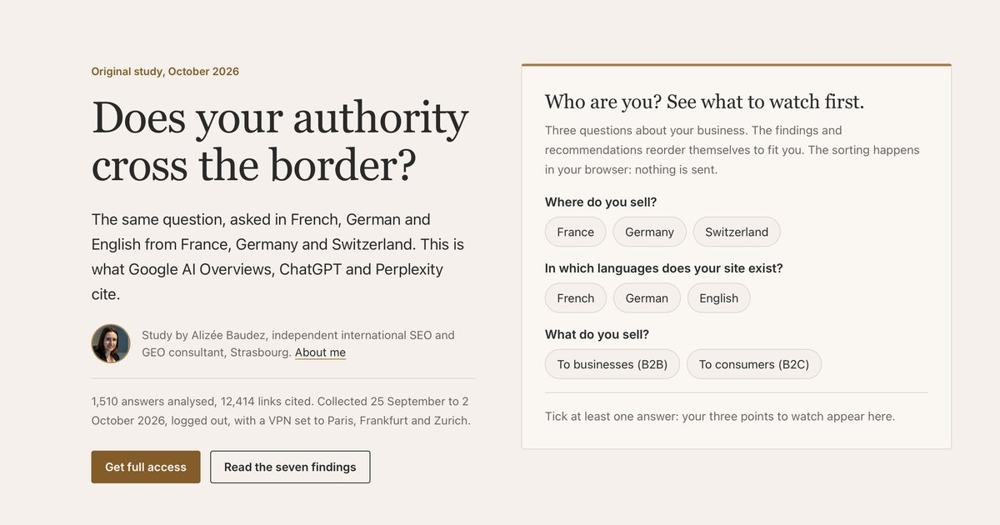

# Cross-border AI visibility study 2026

> **The study has moved to [alizeebaudez.com](https://alizeebaudez.com/en/research/cross-border-ai-visibility-study)** ([français](https://alizeebaudez.com/fr/recherche/etude-visibilite-ia-transfrontaliere)). The GitHub Pages addresses below now redirect there; the original microsite is in this repository's history.

**Does a brand's authority in AI answers cross the border with it?** I asked Google AI Overviews, ChatGPT and Perplexity the same 24 questions in French, German and English, from France, Germany and Switzerland. 1,944 test runs, 1,510 answers analysed, 12,414 links cited.

**[Read the study](https://alizeebaudez.github.io/multi-market-ai-visibility-study/)** · [Français](https://alizeebaudez.github.io/multi-market-ai-visibility-study/fr/) · [Deutsch (beta)](https://alizeebaudez.github.io/multi-market-ai-visibility-study/de/)

## Three findings

**1. Language is the border that counts.** On Google, two answers in the same language from two different countries share 32% of their cited sites. Two answers from the same country in two languages share 8%. On Perplexity the gap is wider: 75% against 5%.

**2. ChatGPT reads your IP address.** On the three questions that depend on where the person asking lives, ChatGPT treats the IP address as the home country in 52 of 81 answers. Google does so in 19 of 67, Perplexity in 5 of 27.

**3. From Switzerland, AI tools cite your neighbours.** Asked in German from Zurich, Perplexity draws 75.3% of its citations from German sites and 5.6% from Swiss ones.

Four more findings, the five hypotheses (two of which failed), the method and its limits are on the [study page](https://alizeebaudez.github.io/multi-market-ai-visibility-study/).

## How it was run

| | |
| --- | --- |
| Tools | Google AI Overviews, ChatGPT, Perplexity |
| Languages | French, German, English (English as the control) |
| Locations | VPN set to Paris, Frankfurt, Zurich |
| Sectors | Cookware (e-commerce) and electrical components and automation (industrial B2B) |
| Questions | 24, written natively in each language, from first problem to purchase |
| Runs | Each test three times, logged out, in a fresh private session |
| Collected | 25 September to 2 October 2026 |

A source counts as stable when it comes back in at least two of three runs. Perplexity refused many logged-out requests, so it ran once per test. The question design follows the method of Luca Fancello (Qwairy).

This is a photograph of one week, not a film. The study page lists every limit.

## What's in this repository

The published microsite, served by GitHub Pages: `index.html` (English), `fr/`, `de/`, and `assets/` (styles, script, data, images). `social/` holds the posts and videos made for each finding. The collection and analysis scripts live elsewhere.

## Who made it

[Alizée Baudez](https://alizeebaudez.com), independent international SEO and GEO consultant in Strasbourg. First presented at Bizz & Buzz, Strasbourg, on 15 October 2026.

To find out what AI tools say about your own brand in each market and language, see the [AI Visibility Sprint](https://alizeebaudez.com/seo-consultancy/ai-visibility-sprint).
